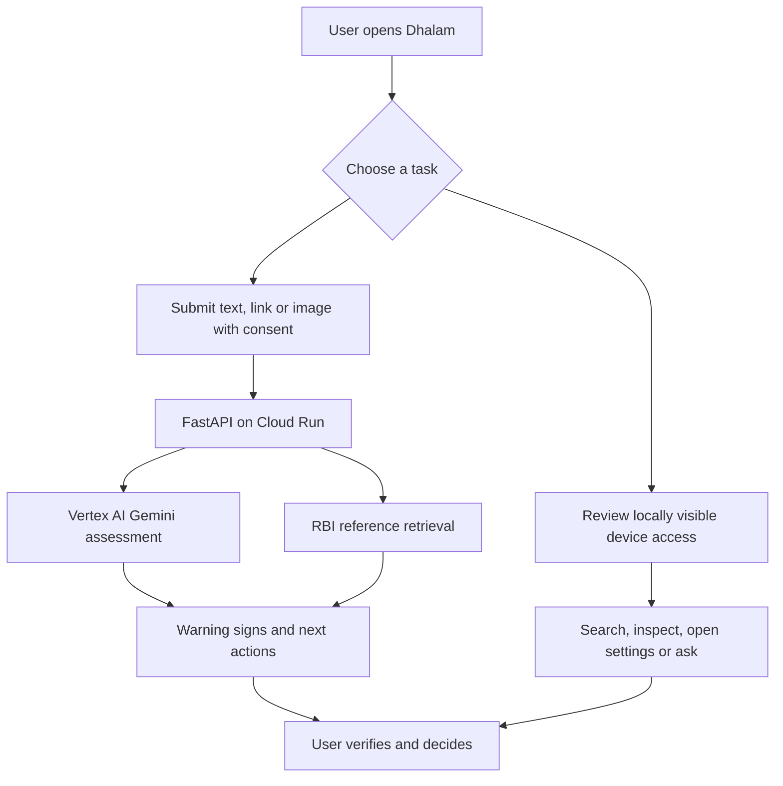

**Dhalam** takes its name from the Sanskrit **ढालम् (*ḍhālam*)**, meaning “a shield.” *Dhalam* is a simplified spelling for the product name. [Monier-Williams Sanskrit–English Dictionary](https://sanskrit.uohyd.ac.in/SKT/MW/103.html)

# Dhalam.AI

### When fear is weaponized, your shield can’t wait.

**Real-time AI scam triage + device defense**

Dhalam.AI gives people a moment to pause when a message, link or screenshot pressures them to act. A user can submit suspicious content for an AI assessment, read the warning signs and suggested next steps, then review relevant access on their Android device. Dhalam helps the user make a decision; it does not make one on their behalf.

This repository contains a working **native Android demo**, a **Flutter Android and iOS client**, and their shared **FastAPI backend**. The native Android app is the current hosted AI demo. The Flutter clients need a locally run backend for AI checks because they do not yet send the Google ID token required by the hosted service.

## Why build this?

Scammers often create urgency and impersonate someone the recipient trusts: a bank employee, an official, an employer or a family member. The dangerous step may be a transfer, an OTP disclosure, a screen share or a change to device access.

The scale of the wider problem is substantial. India’s Ministry of Home Affairs reported **24,02,579 financial cyber-fraud complaints** and **₹22,495 crore in reported fraud amounts** for 2025. These are broader cyber-fraud figures, **not a count of social-engineering incidents**, and the underlying reporting data can change. [Source: Ministry of Home Affairs / PIB, 11 February 2026](https://www.pib.gov.in/PressReleasePage.aspx?PRID=2226441&lang=1&reg=1)

Dhalam is designed for everyday people using digital payments, messaging and banking across India, including people who are less confident interpreting technical warnings. Its first target is the individual or family facing a suspicious request. The proposed commercial route is **B2B2C**: after consumer validation, an institution could offer a narrowly scoped version of the protection to its customers or community.

## What the demo does

| Capability | Current behavior |
| --- | --- |
| **Scam check** | The user submits text, a link or a screenshot with consent. Gemini returns a structured concern assessment, warning signs and ranked actions. A low-concern result does not certify safety. |
| **Reference-backed guidance** | The backend retrieves relevant summaries of official RBI advisories from a small SQLite/sqlite-vec index. The app shows validated source citations when a relevant reference is available. |
| **Device-access review** | Android screens show the apps visible to Dhalam, their requested permissions and reported grant states, plus enabled accessibility services and available device-setting signals. Users can search and inspect findings. |
| **Ask Dhalam** | In the native Android app, users can ask questions about a recent device scan. Some questions are answered locally; backend answers are checked against supplied scan evidence IDs. |
| **Access-change history** | Local scans record observations and compare known accessibility-service and permission states. Scheduled checks and notifications are subject to Android scheduling and permission limits. |
| **Capture awareness** | Supported platform APIs can show a warning about screen capture while Dhalam is visible. Coverage differs by OS version; this does not detect every recording method or activity inside another app. |
| **Incident review** | Users can preview a report and choose whether to share it through the device’s share sheet. Dhalam does not send or file a complaint automatically. |
| **Six-language interface** | English, Hindi, Marathi, Bengali, Tamil and Telugu are available across the principal app screens. Voice input and read-aloud depend on speech services installed on the device and still need broader physical-device validation. |
| **WhatsApp test bot** | Approved testers can send `CHECK:` with text, or `CHECK` with an image caption, to a Meta test number. The sender allowlist and test-number setup make this a controlled demo, not a public WhatsApp service. |
| **Android TV companion review** | With Dhalam installed on both supported Android devices, a phone can review a TV’s shared app and permission inventory after Bluetooth pairing, a short-lived code and approval on the TV. |

The [interaction guide](docs/interact-with-app/README.md) walks through the demo. The [submission pitch](docs/submission/Dhalam_AI_Pitch_Final.pdf) presents the product journey, screenshots and proposed roadmap.

## How it works



The **native Android app** is built with Kotlin and Jetpack Compose. Android APIs provide the device observations; WorkManager schedules periodic checks. Local scan facts use ObjectBox, while app history and review state have their own local storage. The Flutter client shares a Dart interface across Android and iOS but can expose only the device information each OS permits.

The **backend** is a FastAPI service deployed to **Google Cloud Run in Mumbai (`asia-south1`)**. It uses **Gemini through Vertex AI** for scam triage and selected consent-based explanations. A separate **`gemini-embedding-001`** path embeds the reviewed RBI reference summaries and retrieves matches from **SQLite + sqlite-vec**. The initial corpus contains **five reviewed summaries from two RBI advisories**, rather than a live fraud database. Only validated retrieved IDs can appear as reference citations.

Cloud Run’s Mumbai location does **not** establish India-only AI processing: the repository’s Vertex AI configuration uses the `global` location. The model ID is configuration-dependent.

## Platform and demo status

| Platform | What you can run | Present constraint |
| --- | --- | --- |
| **Native Android** (`app/`) | Install the included demo APK or build with Android Studio. It is the current client for the hosted, Google-authenticated AI service. | Hosted AI requires a Google account accepted by the demo backend and an OAuth configuration matching the app’s signing key. Android package visibility limits the device inventory. |
| **Flutter Android** (`flutter/`) | Build from source for scam triage, local checks and the shared interface. | Use a local backend for AI checks. The client does not yet supply the Google ID token required by the hosted Cloud Run service. |
| **Flutter iOS** (`flutter/`) | Build from source and use a local backend for AI checks. | iOS does not expose Android-style inventories of other apps’ permissions or accessibility services. A physical-device build requires Apple signing. |
| **Android TV companion** | Install the native app on a supported TV and pair it with a supported Android phone. | Requires Bluetooth Classic RFCOMM on both devices, Dhalam on both devices and one-time approval on the TV. Pairing alone cannot reveal a TV’s inventory. |

A permission grant is **not proof that an app used that permission**, and a missing app in the inventory is **not proof that it is absent from the device**. Developer settings that Android does not expose are presented for manual review rather than guessed as enabled or disabled.

## Try the native Android demo

The repository includes a **version 1.0.2 demo APK signed with a debug key** at [`build/apks/dhalam-native-android.apk`](build/apks/dhalam-native-android.apk). It is a test artifact, not a production-signed release.

1. Start an Android emulator or connect an Android device and confirm that `adb devices` lists it.
2. From the repository root, install and launch the APK:

   ```bash
   adb install -r build/apks/dhalam-native-android.apk
   adb shell am start -n com.dhalam.ap/.MainActivity
   ```

3. Sign in with a Google account allowed by the demo backend. Try **Scam check** with a fictional message, or open the device-access screens and run a scan.
4. If Google sign-in fails on a build you produced yourself, check that its Android package name and **signing-key SHA-1** match the registered Android OAuth client. See [the detailed run guide](view_app.md).

The hosted backend can reject an otherwise valid Google sign-in if that account is outside its demo allowlist. Do not put AI keys or service-account credentials in the mobile app.

## Run from source

Clone the repository and run the commands below from its root unless a step changes directories:

```bash
git clone https://github.com/abhnovice/Dhalam-Hack2Skill.git
cd Dhalam-Hack2Skill
```

### Native Android

Open the repository root in Android Studio and select the `app` configuration. The project targets **Android API 37** with a **minimum API level of 26**. Its Gradle toolchain requires a complete JDK; the project’s run guide specifies **JDK 25**, including `jlink`.

For a hosted AI build, supply your configured **Web OAuth client ID** through the `DHALAM_GOOGLE_WEB_CLIENT_ID` environment variable or a Gradle property. The checked-in `gradle.properties` supplies the hosted backend URL, but not the OAuth client ID. Your Android signing certificate must also be registered for that OAuth setup.

```bash
./gradlew :app:installDebug
./gradlew testDebugUnitTest
```

A debug-only local unlock is described in [view_app.md](view_app.md). It opens local screens; it is **not** a credential for the hosted AI service. To refresh the shareable demo APK, maintainers can use `python3 tools/build_native_demo.py` with their private backend configuration.

### Backend for local development

Use Python **3.11+** and Google Cloud Application Default Credentials for the configured Vertex AI project. The repository documents a conda environment named `fastapi-rag`; another Python environment with the same dependencies also works.

```bash
cp backend/.env.example backend/.env
python -m pip install -r backend/requirements-dev.txt
gcloud auth application-default login
python -m backend.check --build-index
python -m uvicorn backend.app:app --host 127.0.0.1 --port 18765 --no-access-log
```

Before starting, edit the ignored `backend/.env` for **your own** project, account and available Gemini model. The index build makes embedding calls and uses Google Cloud quota. The API health check is `http://127.0.0.1:18765/health`. See [backend setup and deployment](backend/README.md) for authentication modes, model settings, index freshness checks and Cloud Run deployment.

### Flutter with the local backend

Keep the backend running in another terminal. For an Android emulator, use its actual device ID:

```bash
adb devices
adb reverse tcp:18765 tcp:18765
cd flutter
flutter pub get
flutter run -d emulator-5554
```

The Flutter Android **debug** build defaults to the local backend in its **Demo connection** setting. Reapply `adb reverse` after restarting the emulator. The iOS simulator can use a backend listening on the development computer’s loopback interface; a physical device needs a reachable development endpoint. Follow the [interaction guide](docs/interact-with-app/README.md) for device-specific steps.

### Checks

```bash
python -m pytest backend/ -q --rootdir=.
./gradlew testDebugUnitTest
```

From `flutter/`:

```bash
flutter analyze
flutter test
```

These commands test implementation behavior. The synthetic backend cases and the recorded hosted smoke checks do **not** establish real-world scam-detection accuracy or fraud-loss reduction.

## Privacy, security and user control

- **User-submitted AI checks require consent.** Android’s local background access checks do not send their observations for routine cloud inference. Separate AI explanations of selected device observations require a user action.
- **Image metadata is removed** by re-encoding accepted images before analysis. The backend limits text, URL and image sizes, validates output structure, uses bounded timeouts and does not follow user-submitted links.
- **Reference retrieval contains public guidance**, not user conversations. Submitted queries, images and query embeddings are not written to the SQLite vector index. The application code does not persist submitted scam content on the backend; Google and Meta services have their own applicable processing and retention practices.
- **Hosted mobile AI requests require verified Google ID tokens.** The backend checks token properties and can restrict access to approved accounts. The WhatsApp webhook uses Meta request signatures, a configured phone ID and a sender allowlist instead of Google sign-in.
- **Local observations have limits.** Android restricts package visibility; OS versions differ in available capture and settings signals. “Unavailable” is not treated as “off” or “safe.”
- **The user remains in control.** Dhalam can point to a relevant settings screen and prepare a report for review. It cannot revoke another app’s permission, stop another app’s recording, block a transfer or file an official complaint.

If money has already been sent or an account may be compromised, contact the bank promptly. In India, **1930** and [cybercrime.gov.in](https://cybercrime.gov.in/) are official routes for reporting suspected cybercrime. Dhalam’s assessment is guidance, not an authentication of a caller, document or website.

## Who we intend to serve

Dhalam starts with **people and families in India** who use smartphones for messaging, payments and banking but may face a convincing request under pressure. That includes shopkeepers, workers, homemakers, students and older adults across urban and rural settings; years of smartphone use do not automatically make someone confident at spotting impersonation or coercion.

The proposed next customer is an **institution with an identifiable user-safety problem**: for example, a smaller fintech, cyber insurer, employer-benefits program or financial-literacy organization. The proposed B2B2C integration and pricing in the pitch are hypotheses, **not a current SDK, contract or validated revenue forecast**.

## Roadmap: evidence before expansion

1. **Consumer validation:** Recruit approximately **50–100 consenting Android testers**, including less technically confident users. Measure whether they understand alerts, complete recommended protective actions and encounter excessive false warnings. The gate is evidence of useful intervention and acceptable usability.
2. **Institutional design partner:** Work toward one documented pilot with a partner that can define, measure and fund the problem. The gate is agreement on measurable outcomes.
3. **Focused B2B2C integration:** If the pilot supports it, package a narrow SDK or API, establish privacy and security controls, and benchmark added benefit against the partner’s existing protections.

The broader product vision includes better regional reach within India, bite-sized interactive scam education, more connected-device categories, in-call risk assistance, a user-reviewed cybersecurity email workflow and proactive practice scenarios. **These are proposed enhancements**, not capabilities of the present demo. On-device Gemma, broad public WhatsApp access, production signing and a fully authenticated Flutter-to-hosted-backend path also remain future work.

## Repository map

| Path | Contents |
| --- | --- |
| [`app/`](app/) | Native Android and Android TV companion code, Jetpack Compose UI, local telemetry and persistence |
| [`flutter/`](flutter/) | Flutter Android and iOS client, including platform-specific bridges |
| [`backend/`](backend/) | Shared FastAPI API, Gemini integration, authentication, WhatsApp test webhook and RBI reference retrieval |
| [`docs/interact-with-app/`](docs/interact-with-app/) | Demo walkthroughs, sample content and WhatsApp tester instructions |
| [`docs/submission/`](docs/submission/) | Final pitch PDF and editable presentation |
| [`tools/i18n/`](tools/i18n/) | Source strings and generation tooling for the six-language interfaces |

The root Gradle project builds the native `app/`. Flutter has its own Android host under `flutter/android/`; both directories are needed for their respective clients.

## Team

**Dhalam.AI** is built by **Anusha Jain** and **Abhyudaya Marya**.

For a guided demo, start with the [interaction walkthrough](docs/interact-with-app/README.md). For the product narrative and validation plan, see the [final pitch](docs/submission/Dhalam_AI_Pitch_Final.pdf).
