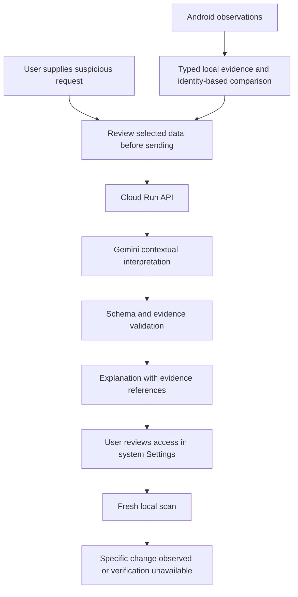

# Dhalam — Hackathon Evaluation and Recommendations

> Historical assessment from 7 November 2026. Its implementation findings,
> test counts, and “today” references do not describe the current app. See
> [the repository README](../README.md) and [the app runbook](../view_app.md)
> for the 9 November demo state.

Evaluation date: November 7, 2026.

**Dhalam is not currently a competitive submission for this hackathon. My win-readiness assessment is 28/100: Weak.**

You have implemented a local security-configuration utility. You have not yet established a differentiated AI product, a compelling adoption reason, or a business case.

**Recommendation: significantly reposition Dhalam. Keep its Android observation capabilities, but stop expanding the general dashboard. Build one focused workflow that connects a suspicious request to observable device access, guides a user through reviewing that access, and verifies the resulting change.**

This is a judgment-based evaluation, not a probability of winning. Confidence is high on the implementation findings, moderate on product strategy, and limited on market demand because no customer-validation evidence was supplied.

I read the entire `ideas.md`, inspected both implementations and their native bridges, checked the official event website, researched competitors, and reran Flutter verification: **11 tests passed; analysis reported no issues.** I did not rerun native builds or physically validate device behavior. No application code was changed.

## 1. What this hackathon actually rewards

The official site describes an AI startup-building program using Google AI and Google Cloud. Its evaluation dimensions are founder profile, product potential, market viability, technical architecture, and use of Google AI/Cloud. Numerical weights are not published.

Applications close **November 13, 2026**; city buildathons run **November 20–21**; regional showcases follow on November 23, 25, and 27; the finale is December 2. Applications include an idea, solution, architecture, and pitch deck. Solo founders and teams may apply; no maximum team size is stated. The site identifies Google DeepMind/Cloud and ecosystem partners Hack2skill, nasscom, and Headstart. [Official event website](https://startupbuildathon.com/)

As of November 7, that gives six calendar days until applications close and thirteen until the city buildathon starts. **November 13 is the application deadline, not an established final prototype deadline.**

I could not verify numerical judging weights, prescribed challenge tracks, exact presentation length, detailed prior-work restrictions, or previous winners of this specific program. The linked terms page did not expose readable terms through the research tool. Do not import rules from similarly named buildathons.

My interpretation of the criteria: a winner needs a convincing startup proposition, working technical evidence, and a material role for Google AI. Adding a Gemini explanation to an otherwise undifferentiated dashboard would improve compliance with the theme but would not resolve the product weakness.

## 2. The idea sheet describes one product, not several competing startup ideas

The optional items—Ask Dhalam, ML inference, URL intelligence, cloud integration—are feature directions within Dhalam. There is no separate portfolio of ideas to rank.

The fundamental problem is currently framed as:

> “People cannot easily understand their device’s security configuration.”

That problem exists, but the proposed solution has three weaknesses:

- **The user segment is undefined.** A security enthusiast, a worried parent, and someone being coached by a fraudulent support caller need different products.
- **The adoption trigger is weak.** Most people do not install another app merely to review configuration information.
- **The outcome is incomplete.** A list of observations leaves the user responsible for interpreting relevance and deciding what to do.

The implementation organizes settings and observations. It does not establish whether access is being abused or whether a scam is occurring. The documentation correctly acknowledges this; the commercial proposition still needs to explain why the resulting utility deserves installation, trust, and payment.

The best direction within the existing assets is:

| Direction | Assessment |
|---|---|
| General security dashboard | Real implementation, weak differentiation and AI fit |
| Generic “Ask Dhalam” chatbot | Easy to build, easy to copy, crowded |
| Accessibility-count risk classifier | Reject: the input cannot establish intent |
| Cross-platform privacy checklist | Useful supporting feature; limited standalone startup case |
| Android access-review assistant grounded in specific observations and user context | Strongest hypothesis; requires implementation and validation |

## 3. What you have actually built

For readability, `F` below means `dhalam_flutter/`; `K` means `Dhalam-Hack2Skill/`.

| Capability | Actual implementation | Evaluation |
|---|---|---|
| Android device observations | Native APIs collect lock/biometric status, accessibility services, visible app permissions, and selected settings | Real functionality; platform integration, not novel detection |
| Flutter platform bridge | Dart calls Kotlin/Swift through method channels | Appropriate architecture for this scope |
| iOS checks | Passcode/biometric observations; cross-app inventories explicitly unavailable | Honest limitations, substantially smaller capability surface |
| Findings | Deterministic mapping from observation strings to labels and guidance | Rules, not AI |
| History | Thirty local snapshots containing findings and inventory counts | Useful journal; inadequate for identifying particular access changes |
| Link inspection | Local parsing and structural heuristics | No reputation, redirects, page inspection, or maliciousness determination |
| Reporting | Preview and native sharing | Implemented utility workflow |
| Native background checks | WorkManager and baseline comparisons | Exists only in the original Android app |
| Native persistence | ObjectBox facts, stable identifiers, category replacement, stale-write checks | Meaningful engineering detail |
| Ask Dhalam | Compose text field retaining entered text | No answer engine |
| ML | Synthetic-data inspection and conflicting-label analysis | No trained model, evaluation, export, or inference |
| Google AI/Cloud | No implementation found in searched application sources/configuration | Major hackathon-fit gap |

Specific evidence (line numbers refer to the audited source):

- [Android telemetry](../flutter/android/app/src/main/kotlin/com/dhalam/dhalam/SecurityTelemetry.kt), line 53, collects OS observations. Accessibility capability flags describe available capabilities; they do not prove those capabilities were exercised.
- [Flutter scanner](../flutter/lib/services/security_scanner.dart), line 13, invokes the native collector and handles unsupported platforms and bridge failures.
- [iOS bridge](../flutter/ios/Runner/AppDelegate.swift), line 18, explicitly returns unavailable cross-app inventories.
- [Finding generation](../flutter/lib/features/security_tools.dart), line 25, uses string matching and fixed guidance.
- [History recording](../flutter/lib/features/security_tools.dart), line 149, reduces service and permission inventories to counts.
- [History comparison](../flutter/lib/features/security_tools.dart), line 223, compares finding text.
- [Ask Dhalam](../app/src/main/java/com/dhalam/ap/SecurityDashboard.kt), line 244, only updates UI state.
- [ML script](../ml/train_model.py), line 1, prints synthetic scenarios and label conflicts.

**The most consequential technical limitation is information loss in history.**

Suppose one service is enabled before and one after, but they are different services. Flutter’s stored accessibility summary remains “1 enabled services reported.” Its comparison cannot identify the replacement.

Likewise, permission grants can move between apps while aggregate counts remain unchanged. This is a structural limitation of what is retained, not a claim that the collector itself misses every such change.

The native [background worker](../app/src/main/java/com/dhalam/ap/SecurityScanWorker.kt), line 44, already compares service identities and known permission transitions. Reuse that reasoning for an explicit foreground workflow. Its scheduled execution is unsuitable as the dependency for an immediate live-demo intervention.

Other concrete findings:

- **Returning from Settings does not refresh Flutter’s device observations.** Its lifecycle handler refreshes notifications and capture status. A fresh security check is still required. [Dashboard lifecycle](../flutter/lib/screens/dashboard_screen.dart), line 49.
- **Android inventory coverage differs between implementations.** Flutter queries text-processing activities; native Android also declares launcher visibility. Neither implies exhaustive inventory. Android documents package filtering explicitly. [Flutter manifest](../flutter/android/app/src/main/AndroidManifest.xml), line 41; [Android documentation](https://developer.android.com/training/package-visibility).
- **Unknown-state handling has an inconsistency.** `NotificationService.areNotificationsEnabled()` converts a missing plugin into `false`, collapsing unavailable into permission denied. [Notification service](../flutter/lib/services/notification_service.dart), line 8.
- **Native storage is more sophisticated than the proposed ML.** Transactional category updates and stale-write protection are genuine technical proof points. They improve correctness, not detection accuracy. [SecurityRepository](../app/src/main/java/com/dhalam/ap/data/SecurityRepository.kt), line 22.
- **Release readiness is incomplete.** Flutter Android release configuration uses debug signing. Native backup rules remain templates despite additional facts/baseline stores. These are release/privacy issues, not automatic hackathon disqualifiers. [Release configuration](../flutter/android/app/build.gradle.kts), line 39.
- **The tests establish Dart behavior under test conditions.** They do not establish OEM inventory coverage, physical capture callbacks, successful native sharing, or real-user outcomes.

Claims such as “AI-powered scam detection,” “real-time protection,” “complete device scan,” “agentic security,” or “verified safe” would currently be indefensible. Your existing documentation mostly avoids these claims; preserve that discipline.

## 4. Competitive reality

| Alternative | Existing capability | Consequence for Dhalam |
|---|---|---|
| Google Play Protect | Harmful-app checks, warnings, and protective actions | A permission dashboard cannot credibly position itself as superior malware protection |
| Apple Safety Check | Reviews and changes sharing/access within supported system scope | iOS guidance alone adds little defensible capability |
| Malwarebytes Scam Guard | Suspicious text, image, and link assistance with explanations | “AI scam companion” is already occupied |
| MobSF | Open-source static/dynamic mobile application security analysis | Broad “advanced mobile security analysis” claims face much deeper tooling |
| Existing hackathon scam checkers | Gemini-based text/screenshot analysis, explanations, and next steps | A generic Gemini pivot is already commonplace |

Sources: [Play Protect](https://support.google.com/googleplay/answer/2812853), [Apple Safety Check](https://support.apple.com/guide/personal-safety/safety-check-faq-ips5f85e089f/1.0/web/1.0), [Scam Guard announcement](https://www.malwarebytes.com/press/2025/06/03/malwarebytes-launches-scam-guard-an-ai-powered-mobile-first-digital-safety-companion-to-combat-todays-most-pernicious-threats), [MobSF](https://github.com/MobSF/Mobile-Security-Framework-MobSF).

For direct hackathon comparisons, [AI Scam Detector](https://devpost.com/software/ai-scam-detector-kifwon) describes Gemini-based text/image analysis; [Is it real?](https://devpost.com/software/is-it-real) describes suspicious-message analysis and explanations; [Scam Spotter](https://devpost.com/software/scam-spotter-65m4sp) describes structured results and screenshot support. These are project authors’ claims, not independently verified quality benchmarks or confirmed winners.

**Why would the current solution beat twenty technically competent teams? It has no convincing answer yet.**

A possible future answer is:

> “We connect what someone is asking you to do with access actually observed on your Android device, then verify a specific access change after your review.”

That is a differentiation hypothesis. It is not proof of uniqueness or a durable moat. Its value must survive a comparison against a generic model given the same user message.

## 5. Scorecard and brutal verdict

The following uses the official dimensions, without inventing official weights.

| Official dimension | Current /10 | Plausible improved /10 | Evidence needed for improvement |
|---|---:|---:|---|
| Founder profile | Unscored | Unscored | Relevant experience, user access, and founder insight |
| Product potential | 4 | 7 | One urgent use case completed end to end |
| Market viability | 2 | 6 | Identified buyer/channel and observed adoption interest |
| Technical architecture | 5 | 7 | Reliable evidence/change/action/recheck workflow |
| Use of Google AI/Cloud | 0 | 7 | Working, grounded AI contribution with measured added value |

The improved scores are conditional targets, not forecasts.

**Top five reasons you could lose:**

1. No working AI integration for an AI-centered event.
2. No compelling explanation of who installs this and why.
3. Existing products already cover much of the broad proposition.
4. The most useful device observations do not lead to a verified user outcome.
5. Effort is spread across migration and utility features instead of one memorable demonstration.

**Five assets that could support a win, after repositioning:**

1. Real Android observations can ground an assistant in more than pasted text.
2. Existing service identities and capability data offer a concrete starting point.
3. Unknown-state handling and timestamped evidence can support credible explanations.
4. Native settings navigation and rescanning can close the action loop.
5. Much of the local infrastructure already exists, reducing the amount that must be built.

**The single biggest weakness is the missing product outcome.** No AI is the most obvious event-fit problem; bolting AI onto the dashboard will not solve the deeper issue.

The gap between current and competitive is:

> Current: “Here are your settings.”  
> Competitive: “Here is the access relevant to this request, why it deserves review, and the change we observed after you acted.”

## 6. Ten deficiencies, ordered by severity

1. **No AI/Cloud implementation:** build a bounded contextual-analysis service, not general chat.
2. **No validated target user or adoption trigger:** focus on Android users reviewing suspicious support requests.
3. **No defensible differentiation:** demonstrate device-grounded value against text-only AI.
4. **Count-only history loses relevant changes:** retain identity-based evidence with availability and timestamps.
5. **No completed intervention loop:** connect evidence to Settings and a fresh verification scan.
6. **No evaluation of detection/advice quality:** create held-out benign, suspicious, ambiguous, and adversarial cases.
7. **Platform ambition dilutes the strongest capability:** concentrate the demonstration on Android.
8. **Native behavior remains insufficiently verified:** record a real-device acceptance matrix.
9. **Current information architecture is a utility collection:** make the incident-review task the primary flow.
10. **Release, data-handling, and contract weaknesses:** resolve signing, explicit unknown states, retention, and deletion for the chosen implementation.

## 7. The strongest feasible version

Reposition as:

> **Dhalam helps Android users review suspicious requests to grant powerful device access, understand the observable evidence, and confirm specific access changes after taking action.**

Initial scenario: someone claiming to provide support asks the user to enable accessibility access. The user brings the request to Dhalam. Dhalam combines that context with observable service state.

Do not presume the caller is fraudulent or the service malicious. A legitimate accessibility service can have powerful capabilities. The product should distinguish **observed access**, **user-reported context**, and **inferred concern**.

The practical adoption problem remains: users must encounter Dhalam before or during the incident. A trusted digital-support organization is a plausible initial distribution channel. It is a hypothesis requiring interviews and pilot interest, not a partnership you can claim.

A simple architecture is sufficient:

Key decisions:

- Keep inventories and snapshots local by default.
- Send only selected relevant observations and user-approved context.
- Use Gemini to interpret language and connect requests to observed capabilities.
- Use deterministic code to calculate changes and constrain available actions.
- Require outputs to reference supplied evidence identifiers.
- Reject nonexistent evidence references, unsupported actions, and malformed responses.
- Treat pasted messages as untrusted content; schema validation alone does not prevent misleading reasoning.
- Store credentials server-side; add endpoint access controls, limits, timeouts, and request-size caps.
- Keep raw incident content out of routine logs.
- Recheck locally; the model must never certify that a device is safe.

Gemini supports structured outputs, but structural validity is not factual validity. [Official structured-output documentation](https://ai.google.dev/gemini-api/docs/structured-output)

No agent framework, vector database, autonomous remediation, or custom classifier is justified for this version.

## 8. Prioritized implementation backlog

Effort estimates are engineering person-hours for someone familiar with the code. They exclude waiting for users, credentials, or organizer decisions. New paths are explicitly marked.

| Priority | Current issue → exact change | Repository location | Judging impact | Effort |
|---|---|---|---|---:|
| P0 | Broad dashboard → document one support-request/access-review scenario and explicit exclusions | `ideas.md`, `F/README.md` | Product potential, market | 2–3h |
| P0 | Count-only history → store normalized service IDs, capabilities, availability, and observation times; handle first-seen separately from newly enabled | `F/lib/models/security_models.dart`, `F/lib/features/security_tools.dart`; reference `K/.../SecurityScanWorker.kt` | Architecture, product | 6–10h |
| P0 | No AI → implement one analysis endpoint with structured evidence references, bounded actions, and timeout fallback | New `backend/`; new `F/lib/services/incident_analysis_service.dart` | Google AI/Cloud, architecture | 8–14h |
| P0 | Disconnected tools → build Context → Evidence → Review action → Recheck flow | New `F/lib/screens/incident_review_screen.dart`; dashboard entry point | Product potential | 6–10h |
| P0 | No proof of benefit → add a held-out scenario set and rules-only/text-only/full-system comparison | New `eval/` | AI depth, credibility | 6–10h |
| P0 | Unverified native loop → test one declared Android device/API combination end to end and record results | New `docs/device-validation.md` | Architecture, demo reliability | 4–6h |
| P1 | Unclear network disclosure → show payload preview and omit unnecessary inventory/context; define retention | Incident screen, backend logging/configuration | Trust, architecture | 3–5h |
| P1 | Missing-plugin status becomes “denied” → represent unavailable explicitly; reject malformed observation contracts | Notification service and models | Correctness | 1–3h |
| P1 | Inventory scope differs → align intended visibility query and expose package/service identity | `F/android/app/src/main/AndroidManifest.xml`, dashboard | Evidence quality | 2–4h |
| P1 | Unproven adoption → conduct five structured user/support interviews and a small task-completion study | New `docs/validation.md` | Market viability, founder insight | 4–8h plus recruitment |
| P1 | Fragile presentation → record the tested workflow, create a labeled replay, and pin the demo build | New `docs/demo.md` and demo assets | Product experience | 3–5h |
| P2 | Release/privacy debt → configure release signing and document deletion/backup scope for the selected app | Android build configuration and storage documentation | Deployment credibility | 3–6h |

Do not migrate CSV exports, ObjectBox, or background monitoring merely to match the original app. None is necessary to prove the recommended workflow.

## 9. Technical proof that would materially change the verdict

Build a proposed initial evaluation set of **40 clearly labeled scenarios**:

- 10 suspicious requests involving access escalation.
- 10 legitimate accessibility/support scenarios.
- 10 ambiguous cases with missing context.
- 10 adversarial cases, including embedded instructions and misleading identities.

Use a separate development set. Do not tune on the held-out cases and then present them as independent evaluation.

Compare:

1. Deterministic checks alone.
2. Gemini given the user’s request alone.
3. Gemini plus validated device evidence and constrained actions.

Measure:

- Unsupported claims about device state.
- Incorrect accusations against legitimate services.
- Appropriateness of recommended actions.
- Correct abstention when evidence is insufficient.
- Evidence-reference validity.
- Successful completion of the action/recheck workflow.
- Median and tail latency, token usage, and observed cost per completed review.

A small synthetic set is a development benchmark, not real-world scam-detection accuracy. For user value, measure whether participants complete the correct review task more reliably than with settings guidance alone. Do not claim money saved or fraud prevented without evidence.

**If device evidence does not improve decisions or task completion over text-only AI, your proposed differentiation fails.**

## 10. Three implementation strategies

| Strategy | Exact scope | Remove/deprioritize | Dependencies and risks | Effort and readiness |
|---|---|---|---|---|
| **A — Minimum viable contender** | One Android scenario, identity-based service comparison, text input, one Gemini endpoint, evidence references, manual action and recheck, small evaluation | Screenshots, iOS expansion, CSV parity, background alerts, general chat | Cloud access; native service visibility; misleading AI advice | **30–45h**. Credible short demo; market weakness remains |
| **B — Strong finalist attempt** | A plus proper held-out comparison, benign controls, data preview, one-device acceptance record, user task study, replay fallback | Additional threat categories, custom ML, multi-language breadth | Recruiting users; measuring genuine advantage; integration reliability | **60–90h total**. Best balance of evidence and scope |
| **C — Winner-caliber attempt** | B plus a second-device validation, consented pilot evidence, measured outcome improvement, and screenshot intake only if users demonstrate the need | Platform parity, autonomous remediation, broad surveillance | External validation and access to representative cases; diminishing returns from features | **110–160h total**, plus elapsed pilot time. Stronger case, no guaranteed result |

**Choose Strategy B as the target, with Strategy A as the mandatory completion gate.** Team capacity was intentionally left unspecified, so a more precise feasibility claim would be invented.

Sequence the work:

1. Freeze scope and specify the observable outcome.
2. Implement identity-based observations and recheck before AI.
3. Add contextual interpretation and output validation.
4. Build the single user flow.
5. Run evaluation and physical-device checks.
6. Gather user evidence.
7. Freeze and rehearse the demonstration.

For the application, show the current implementation honestly and clearly separate the proposed buildathon work. Do not imply pre-existing code was built during the event.

## 11. Five hostile judges and fifteen questions

The answers below distinguish what you can say now from what becomes defensible after implementing the recommendation.

### Innovation judge — 3/10 currently

Three weaknesses: familiar dashboard category; absent AI; no proven differentiated outcome.

Score improvement: demonstrate a task that benefits measurably from combining user context with live device observations.

Credibility risk: describing the proposed capability as already implemented or globally unique.

1. **“Why isn’t this another scam chatbot?”**  
   Today, it is a configuration dashboard, not a functioning scam chatbot. The proposed distinction is device-grounded access review and verified state change. That distinction must be demonstrated.

2. **“Why can’t Gemini do this alone?”**  
   A generic conversation does not automatically receive this app’s native observations or verify the subsequent setting change. However, comparison against a text-only baseline must show that those observations help.

3. **“What is your moat?”**  
   None is established. Potential defensibility would come from validated workflows, distribution, and a representative evaluation corpus—not the API integration.

### Technical-depth judge — 5/10 currently

Three weaknesses: lossy history; unverified native boundaries; absent AI evaluation.

Score improvement: typed evidence, availability-aware comparisons, constrained AI output, and repeatable native tests.

Credibility risk: presenting capability flags as proof of surveillance or scheduled checks as immediate detection.

4. **“How do you know this app is malicious?”**  
   We do not. We observe access and interpret a supplied request. The product must avoid turning those observations into a malware verdict.

5. **“What happens if one service replaces another?”**  
   Current Flutter history can miss it because counts remain equal. The revised flow must compare normalized service identities; the original worker provides a useful precedent.

6. **“What does your agent actually execute?”**  
   There is no agent today, and one is unnecessary here. The proposed workflow collects observations, validates an explanation, opens supported settings, and rescans after user action.

### Business-impact judge — 2/10 currently

Three weaknesses: no defined buyer; no demonstrated acquisition channel; no measured outcome.

Score improvement: a narrow distribution hypothesis, interviews, and observed completion of a useful task.

Credibility risk: presenting interested contacts as customers or a proposed pilot as traction.

7. **“Who pays?”**  
   Not established. A support organization is an initial buyer/channel hypothesis. We need evidence of willingness to adopt and pay.

8. **“Why would someone have this installed before a scam?”**  
   That is an unresolved adoption risk. Trusted support distribution may address it; a purely reactive consumer-install assumption is weak.

9. **“How much fraud have you prevented?”**  
   None demonstrated. Initial claims should concern review-task completion and observed access changes, not prevented losses.

### Product-experience judge — 4/10 currently

Three weaknesses: fragmented utilities; technical information without prioritization; manual refresh breaks continuity.

Score improvement: one coherent review flow with an explicit outcome and an understandable unavailable state.

Credibility risk: a green completion screen interpreted as whole-device safety.

10. **“What happens when the network fails?”**  
    Existing local checks remain available. The proposed AI feature must show that contextual interpretation is unavailable and offer fixed, scoped guidance.

11. **“What happens to a legitimate accessibility user?”**  
    Enabled accessibility must not automatically trigger a malicious label. Legitimate scenarios belong in the evaluation, and the user retains control over changes.

12. **“Can you verify the fix?”**  
    We can potentially verify a specific supported observation, such as a service no longer appearing enabled in a fresh successful read. We cannot verify that the entire device is safe.

### Hackathon-fit judge — 1/10 currently

Three weaknesses: no Google AI; no Cloud integration; no startup-validation evidence.

Score improvement: a deployed AI-enabled workflow whose contribution is measurable, supported by a credible market argument.

Credibility risk: claiming AI functionality that does not exist, or mishandling event prior-work requirements. Exact disqualification rules remain unverified.

13. **“Where is Google AI used?”**  
    Currently nowhere in the audited implementation. In the proposed version, Gemini interprets user-supplied requests against selected evidence through a Cloud-hosted endpoint.

14. **“Did you add AI just for the contest?”**  
    AI is not needed for counting services or detecting changes. Its justification is interpreting varied natural-language requests. The baseline comparison must demonstrate whether it earns that role.

15. **“What did you build during the event?”**  
    Disclose the existing dashboard and native collectors. Identify the new incident workflow, AI service, evaluation, and verification work precisely, subject to the organizer’s rules.

## 12. The demo that could change the judging conversation

Use a four-minute structure as a planning assumption, not an official duration.

| Time | Demonstration |
|---|---|
| **0:00–0:25** | Hook: “A support caller asks you to enable an accessibility service. The permission is real. Whether you should grant it depends on the situation.” |
| **0:25–0:50** | Show a clearly labeled staged request and a controlled demo service. Explain the user’s uncertainty. |
| **0:50–1:30** | Run the observation. Show service identity, reported capabilities, and timestamp. Supply the request context with an explicit data preview. |
| **1:30–2:05** | Show the explanation tied to evidence. Separate observed facts from contextual concern. |
| **2:05–2:45** | User opens Settings, disables the controlled service, returns, and rechecks. Show the exact observed transition. |
| **2:45–3:15** | Show a benign accessibility case where the product avoids an unsupported accusation. |
| **3:15–3:40** | Present measured baseline results, including failures and limitations. |
| **3:40–4:00** | State the target user, distribution hypothesis, and actual validation obtained. Close with the verified outcome. |

**The wow moment is the fresh, identity-specific recheck after user action.**

The explanation makes the situation understandable; the recheck makes it concrete. That is more memorable than another model-generated paragraph.

Closing line:

> “Dhalam connects a suspicious request to observable access and helps the user verify a specific change.”

Do not show:

- Every dashboard tab.
- CSV export.
- Developer-option trivia.
- An empty Ask Dhalam field.
- Synthetic classifier results.
- A long explanation of framework choices.
- Unsupported claims of malware detection or automatic protection.

For fallbacks:

- Record the exact tested device flow.
- Label prerecorded evidence and replayed model output explicitly.
- If AI fails, show local observations and the actual unavailable state.
- If native observations fail, do not substitute fixture data without labeling it.
- Do not make screen-recording detection the central demonstration; supported behavior and presentation capture can complicate it.

## Final recommendation

Continue with the existing codebase, but **significantly reposition the product**. Stop prioritizing cross-platform parity, CSV migration, speculative ML, and generic chat.

The highest-value immediate change is to replace count-only accessibility history with an **identity-based observe → review → recheck workflow**. That creates the evidence and outcome on which a useful AI feature can be built.

Your current submission demonstrates that you can collect security-related information. A competitive submission must demonstrate that a specific user can make a better decision and complete a verifiable action because of it.
